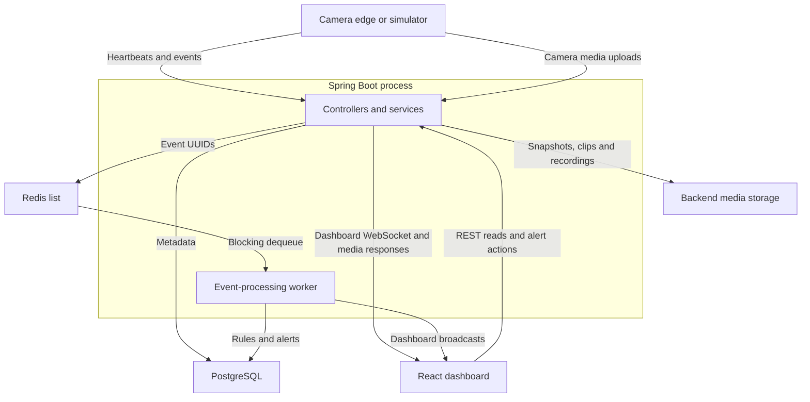
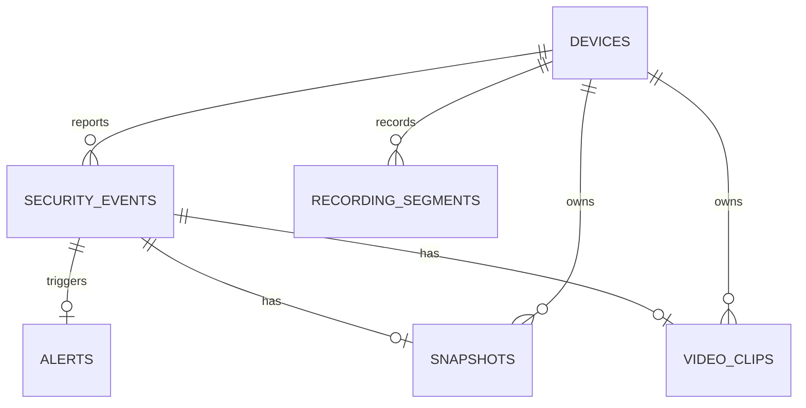

# Architecture

SentinelMesh runs a Java camera client, a Spring Boot backend, a React dashboard, PostgreSQL, and Redis. The simulator and benchmark modules are supporting clients. This document describes the published implementation; it does not assume MQTT ingestion, user authentication, or a production deployment.

## Components



| Component | Responsibility | Source |
| --- | --- | --- |
| Camera edge | Capture frames; motion/optional person detection; heartbeat; live JPEG publication; snapshots/clips; recording spool and uploads | [cv_edge_node](../cv_edge_node/src/main/java/com/sentinelmesh/edge) |
| REST services | Validate requests, selected device authentication, persistence, and media retrieval | [backend packages](../backend/src/main/java/com/sentinelmesh) |
| Redis queue/worker | Queue event UUIDs and evaluate rules outside the ingestion response | [async](../backend/src/main/java/com/sentinelmesh/async) |
| PostgreSQL/JPA | Durable device, event, rule, alert, and media metadata | [entities](#database-relationships) |
| Media storage | Files under configured snapshot/clip/recording roots | [storage configuration](../backend/src/main/resources/application.yml) |
| Live-frame store | Latest JPEG per camera, held in memory and expired when stale | [live](../backend/src/main/java/com/sentinelmesh/live) |
| Dashboard | REST views, polling every five seconds when auto-refresh is enabled, and refreshes triggered by WebSocket messages | [App.tsx](../frontend/src/App.tsx) |

## Device-to-backend data flow

1. **Registration:** `DeviceController` accepts a device description. `DeviceService` generates a random API key, persists its SHA-256 hash with an initially offline device, and returns the raw key in the creation response only.
2. **Heartbeat:** the client sends its device UUID and `X-Device-Api-Key`. Authentication checks the stored hash; the backend sets `ONLINE` and updates `lastSeenAt`.
3. **Detection:** the camera client performs motion detection and, when configured, asynchronous person detection. Its cooldown/confirmation logic controls event submission.
4. **Ingestion:** the backend authenticates the event request, saves `SecurityEvent`, enqueues its UUID, broadcasts `SECURITY_EVENT_CREATED`, and returns HTTP `201`.
5. **Rule evaluation:** the worker dequeues the UUID, loads the event, evaluates enabled rules, stores at most one alert, and broadcasts `ALERT_CREATED` when one is created.
6. **Dashboard refresh:** a message causes the browser to reload relevant REST data. Polling is a separate fallback, including for offline changes that the monitor does not broadcast.
7. **Media:** snapshots and clips attach to an event; continuous segments attach directly to a device. The edge's local recording spool holds work across upload attempts.

The ingestion transaction, Redis enqueue, and WebSocket broadcast are not a transactional outbox. A worker can dequeue before the database transaction commits, and a process failure after dequeue can lose the evaluation attempt. The current worker logs failures but does not requeue them. Documented `max-attempts`/worker-delay entries in the Docker YAML are not implemented by `EventProcessingProperties` or this worker.

## Liveness and live preview

`DeviceStatusMonitor` checks every 10 seconds for online devices with no heartbeat timestamp or one more than 30 seconds old, then marks them offline. A later authenticated heartbeat restores online status.

Live preview uploads are JPEGs; `LiveFrameStore` retains only the latest frame for each camera. `LiveFrameService` treats a frame older than 10 seconds as stale. `GET /api/devices/{deviceId}/live` streams `multipart/x-mixed-replace; boundary=frame` with JPEG parts. It is video-only MJPEG, not an audio stream.

Camera overview combines heartbeat status and frame availability:

| Device/frame state | Camera live status |
| --- | --- |
| Offline device | `UNAVAILABLE` |
| Online device with a fresh frame | `LIVE` |
| Online device without a fresh frame | `STALE` |

Live bytes are not saved in PostgreSQL or Redis. Restarting the backend clears them; the edge must publish another frame. Continuous recordings and event media are separate files.

## API conventions

- JSON requests use `Content-Type: application/json`. Multipart uploads use their documented field names.
- UUIDs identify devices, events, alerts, rules, and database media rows. Timestamps use ISO-8601 instants, normally UTC with a trailing `Z`.
- `X-Device-Api-Key` is required only on the protected routes listed below. Other current routes do not gain authentication merely because a client sends that header.
- REST responses use DTOs rather than returning the device key hash.
- Paged responses contain `content`, `page`, `size`, `totalElements`, `totalPages`, `first`, `last`, `hasNext`, and `hasPrevious`.
- Media DTO URLs are relative to the backend. Resolve them against your API base URL.

### Core endpoint contracts

| Method and route | Request | Successful result |
| --- | --- | --- |
| `POST /api/devices` | JSON: `name`, `type`, optional `location`; operational examples supply a location | `201`; device fields plus one-time raw `apiKey` |
| `GET /api/devices` | None | `200`; array of devices |
| `GET /api/devices/{id}` | Device UUID | `200`; one device, without its key |
| `PATCH /api/devices/{id}` | JSON with fields to update | `200`; updated device |
| `DELETE /api/devices/{id}` | Device UUID | `204` on successful deletion; linked data can prevent deletion |
| `POST /api/devices/{id}/heartbeat` | Key header; JSON `status` | `200`; refreshed online device |
| `POST /api/devices/{deviceId}/events` | Key header; event JSON below | `201`; saved event, before asynchronous alert completion |
| `GET /api/events` | None | `200`; array of events |
| `GET /api/events/{id}` | Event UUID | `200`; event including media availability |
| `GET /api/devices/{deviceId}/events` | Device UUID | `200`; array of that device's events |
| `GET /api/events/recent` | `page=0`, `size=50` defaults | `200`; newest-first event page |
| `POST /api/rules` | Rule JSON below | `201`; new rule |
| `GET /api/rules`, `GET /api/rules/{id}` | Optional rule UUID | `200`; array or rule |
| `PATCH /api/rules/{id}` | Rule update JSON | `200`; updated rule |
| `PATCH /api/rules/{id}/enable` or `/disable` | No body | `200`; enabled/disabled rule |
| `DELETE /api/rules/{id}` | Rule UUID | `204` |
| `GET /api/alerts`, `GET /api/alerts/{id}` | Optional alert UUID | `200`; array or alert |
| `GET /api/alerts/recent` | `page=0`, `size=50` defaults | `200`; newest-first alert page |
| `GET /api/alerts/open` | `page=0`, `size=50` defaults | `200`; page of `OPEN` alerts |
| `GET /api/alerts/open?severity=HIGH` | Severity enum | `200`; **array**, not the paged response shape |
| `PATCH /api/alerts/{id}/acknowledge` | No body | `200`; status `ACKNOWLEDGED` |
| `PATCH /api/alerts/{id}/resolve` | No body | `200`; status `RESOLVED` |
| `GET /api/health` | None | `200`; static service `UP` response, not a dependency check |

Event and alert pages clamp page to at least zero and size to `1..100`. Unpaged list routes do not provide that bound.

Registration example:

```json
{
  "name": "Lab Camera",
  "type": "CAMERA",
  "location": "Lab"
}
```

Event example:

```json
{
  "eventType": "MOTION_DETECTED",
  "severity": "HIGH",
  "confidence": 0.9,
  "occurredAt": "2026-10-14T12:00:00Z",
  "metadataJson": "{\"source\":\"manual-smoke-test\"}"
}
```

`eventType` and `severity` are required. `confidence` is optional but must be within `[0,1]`; `occurredAt` is optional; `metadataJson` is a string of at most 5,000 characters.

Rule example:

```json
{
  "name": "Lab camera motion",
  "description": "Create a high-priority alert for camera motion.",
  "eventType": "MOTION_DETECTED",
  "minimumSeverity": "HIGH",
  "deviceType": "CAMERA",
  "alertSeverity": "HIGH",
  "alertTitle": "{deviceName}: {eventType}",
  "alertMessage": "{deviceName} at {deviceLocation} reported {severity} motion."
}
```

Rules default to enabled when created. Conditions may be null to act as wildcards. The first matching rule wins; there is no explicit priority field.

### Camera and media contracts

| Method and route | Request | Successful result / authentication |
| --- | --- | --- |
| `GET /api/cameras`, `GET /api/cameras/{deviceId}` | Camera UUID for details | `200`; camera summaries/details; no key check |
| `POST /api/devices/{deviceId}/live-frame` | Multipart `file`: JPEG, maximum 2,000,000 bytes | `204`; camera validation, no device-key check |
| `GET /api/devices/{deviceId}/live` | Camera UUID | MJPEG stream; no device-key check |
| `POST /api/devices/{deviceId}/events/{eventId}/snapshot` | Key header; multipart `file` | `201`; snapshot metadata with ownership/key checks |
| `GET /api/snapshots/{snapshotId}` or `/api/events/{eventId}/snapshot` | Snapshot or event UUID | `200`; snapshot metadata |
| `GET /api/snapshots/{snapshotId}/image` | Snapshot UUID | Image resource |
| `POST /api/devices/{deviceId}/events/{eventId}/clip` | Multipart `file`: MP4 | `201`; event/device ownership validation, no key check |
| `GET /api/clips/{clipId}` or `/api/clips/{clipId}/video` | Clip UUID | Metadata or MP4 resource |
| `POST /api/devices/{deviceId}/recordings/segments` | Multipart `file`, `segmentId`, `segmentStartTime`, `segmentEndTime` | `201`; segment metadata; no key check |
| `GET /api/recordings/segments/{segmentId}` or `/video` | Stable edge-generated `segmentId` | Metadata or MP4 resource |
| `GET /api/devices/{deviceId}/recordings/segments/recent` | Device UUID | `200`; up to 20 latest segments |
| `GET /api/devices/{deviceId}/recordings/segments` | Required `start`/`end`; defaults `page=0`, `size=25` | `200`; timeline containing a segment page, gaps, and aggregate fields |

Recording uploads have two UUIDs: `id` is the backend primary key, while `segmentId` is the edge-generated unique retry identifier used by metadata/video retrieval URLs. For sequential retries on the same device, upload returns the existing segment; the controller still returns `201`. Use the response's `videoUrl` to follow the retrieval contract.

Configured file limits are 5 MiB for snapshots, 50 MiB for event clips, and 100 MiB for recording segments. The servlet multipart limit is 128 MB for both file and request. Live uploads have their separate 2,000,000-byte cap.

### Errors

| Status | Examples |
| --- | --- |
| `400` | Bean validation, malformed JSON/enums, missing required headers/parameters, non-camera live/detail requests, invalid recording time range |
| `401` | Incorrect device key on routes that authenticate it |
| `403` | Explicit clip/recording ownership exceptions |
| `404` | Missing device, event, alert, rule, or recording metadata where the corresponding handler is present |
| `409` | Duplicate event clip |
| `413` | Servlet multipart upload limit exceeded |
| `500` | Clip/recording storage exceptions or unhandled failures |

Handled application errors normally include `timestamp`, `status`, `error`, and `message`; bean validation uses a `messages` array. Framework errors and exceptions without a specific handler can have different bodies/statuses. In particular, not every media exception currently has a dedicated handler.

## Dashboard WebSocket contract

Endpoint: `ws://localhost:8080/ws/dashboard`. It is a native WebSocket endpoint, not STOMP. The backend allows origin `http://localhost:5173`.

```json
{
  "type": "SECURITY_EVENT_CREATED",
  "timestamp": "2026-10-14T12:00:00Z",
  "payload": {
    "eventId": "<event UUID>",
    "deviceId": "<device UUID>",
    "deviceName": "Lab Camera",
    "eventType": "MOTION_DETECTED",
    "severity": "HIGH"
  }
}
```

Message types include device registration/heartbeat/status changes, event creation, alert creation/acknowledgement/resolution, and rule creation/update/deletion. Payload fields depend on the type. The browser reconnects after about three seconds; broadcasts have no persistence or replay. The offline monitor currently does not emit a status-change broadcast.

## Database relationships



| Table | Keys and important relationships |
| --- | --- |
| `devices` | UUID `id`; name/type/location, status, `api_key_hash`, `last_seen_at`, creation/update times |
| `security_events` | UUID `id`; required `device_id` foreign key; event type/severity/confidence, occurrence/receipt times, metadata |
| `alerts` | UUID `id`; required unique `security_event_id`, allowing at most one alert per event; severity, status, title/message, lifecycle timestamps |
| `alert_rules` | UUID `id`; enabled flag, optional matching conditions, and alert output/template fields; no rule foreign key is stored on an alert |
| `snapshots` | UUID `id`; required `device_id` and unique `event_id`; filename/type/size/dimensions/path metadata |
| `video_clips` | UUID `id`; required `device_id` and unique `event_id`; MP4 metadata |
| `recording_segments` | UUID `id`; unique edge `segment_id`; required `device_id`; start/end times, duration, file/path metadata |

Media bytes reside on disk, not in these tables. In Docker, the configured roots are below `/app/storage`, bound to `backend/storage/` on the host. Recording paths are partitioned by device and UTC year/month/day/hour. Device deletion is not a documented cascade purge of its events and media.

## Deployment and current boundaries

- Compose runs one backend process. Redis dequeues work across workers, but the live-frame store and WebSocket sessions remain local to a backend process; multi-instance behavior needs additional design.
- Hibernate updates the schema at startup. Versioned schema migrations are not currently included.
- Device-key checks are uneven across endpoints, and dashboard/admin reads and writes have no user authorization layer. CORS restricts browser origins; it does not authenticate clients.
- The published retention service can delete segments when called, but no backend retention scheduler or reconciliation workflow is wired in.
- Review the [requirements](requirements.md) for acceptance scope and the [runbook](runbook.md) for operating this local stack.
